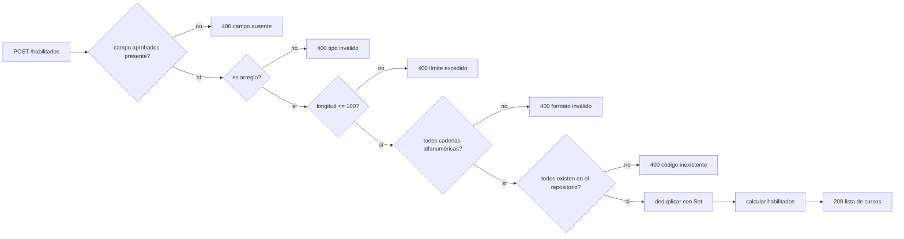
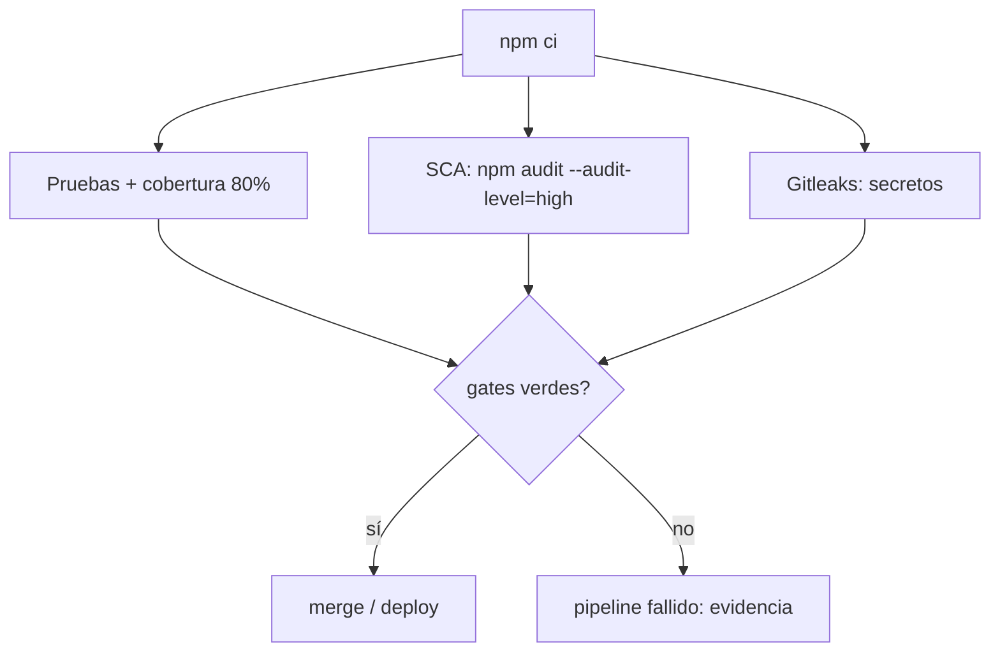

# Diseño: Cursos habilitados

## Overview

*(Visión general)*

Endpoint `POST /habilitados` que calcula, a partir de la lista de cursos aprobados enviada por el alumno, los cursos de la malla en los que puede matricularse. La lógica de validación y cálculo vive en módulos puros, separados de la capa HTTP, para que sea testeable sin levantar el servidor. Los datos se leen exclusivamente a través del Repositorio existente (`src/data/repositorio.js`).

## Architecture

*(Arquitectura)*

- Express 4, CommonJS (`require`), sin TypeScript, sin dependencias npm nuevas (las herramientas de seguridad corren como acciones de GitHub Actions, no como paquetes del proyecto).
- La ruta `POST /habilitados` se registra en un router nuevo `src/routes/habilitados.js`, montado en `src/app.js`.
- El router delega la validación y el cálculo a módulos puros:
  - `src/data/cursos-habilitados.js`: cálculo de cursos habilitados a partir de los aprobados y el catálogo del Repositorio.
  - La validación de la solicitud se implementa como funciones puras exportadas desde el mismo módulo de cálculo o desde `src/util/validar-aprobados.js`, según quede más legible en la implementación; en ambos casos son funciones puras sin acceso a `req`/`res`.
- No se modifica `data/cursos.json` en ninguna ruta de ejecución.

### Diagrama de flujo de la solicitud



## Components and Interfaces

*(Componentes)*

| Componente | Responsabilidad |
| --- | --- |
| `src/routes/habilitados.js` | Define `POST /habilitados`. Parsea el cuerpo, invoca validación y cálculo, traduce el resultado a una respuesta HTTP. |
| `src/data/cursos-habilitados.js` (o `src/util/validar-aprobados.js` + cálculo) | Funciones puras: validación de forma del payload, verificación de existencia contra el Repositorio, y cálculo de habilitados. |
| `src/data/repositorio.js` | Única vía de acceso a `data/cursos.json`. Se reutiliza sin cambios. |
| `src/app.js` | Monta el router nuevo en `/habilitados`. |
| `tests/habilitados.test.js` | Pruebas de ruta con supertest sobre `src/app.js`. |
| `tests/habilitados-calculo.test.js` | Pruebas de las funciones puras de validación/cálculo. |
| `.github/workflows/ci.yml` | Añade gates de SCA (`npm audit`) y Gitleaks; mantiene el gate de cobertura. |
| `TRAZABILIDAD.md` | Registra requisito → gate → evidencia. |

## Contratos

`POST /habilitados` con cuerpo `{"aprobados": ["1INF25", "1INF27", "1INF49"]}` → `200`:

```json
[
  { "id": "1INF29", "name": "...", "credits": 5.0, "cycle": 6, "type": "obligatorio" },
  { "id": "1INF30", "name": "...", "credits": 5.0, "cycle": 6, "type": "obligatorio" }
]
```

- Cada curso de la respuesta incluye `id`, `name`, `credits`, `cycle` y `type` (mismos campos que devuelve `GET /cursos` sin prerrequisitos expandidos; los prerrequisitos ya están implícitos en el cálculo).
- Con el ejemplo anterior, la respuesta contiene exactamente 27 cursos, incluyendo `1INF29`, `1INF30`, `1INF31` y `1INF32` (requisito 1.3).
- La respuesta se ordena por `id` ascendente para que el contrato sea determinista y verificable.

Errores, siempre con cuerpo `{"error": "<mensaje>"}` y código 400:

| Caso | Respuesta |
| --- | --- |
| Campo `aprobados` ausente | `400 { "error": "el campo 'aprobados' es obligatorio" }` |
| `aprobados` no es arreglo (p. ej. cadena) | `400 { "error": "'aprobados' debe ser un arreglo de cadenas" }` |
| Algún elemento no es cadena | `400 { "error": "'aprobados' debe ser un arreglo de cadenas" }` |
| Más de 100 elementos | `400 { "error": "'aprobados' admite como máximo 100 elementos" }` |
| Formato inválido (p. ej. `1INF30<script>`) | `400 { "error": "formato de código inválido" }` |
| Código inexistente (p. ej. `1INF99`) | `400 { "error": "código de curso inexistente: <código>" }` |

Error no controlado: `500 { "error": "internal server error" }`, manejado por el middleware de errores ya existente en `src/app.js` (requisito 3.1).

## Algoritmo de cálculo

```js
// src/data/cursos-habilitados.js
const repositorio = require('./repositorio');

function calcularHabilitados(aprobados) {
  const aprobadosSet = new Set(aprobados);

  return repositorio
    .listar()
    .filter(curso =>
      !aprobadosSet.has(curso.id) &&
      (curso.prerequisites || []).every(
        pre => aprobadosSet.has(pre)
      )
    )
    .sort((a, b) => a.id.localeCompare(b.id))
    .map(({ id, name, credits, cycle, type }) => ({
      id, name, credits, cycle, type
    }));
}
```

- Se construye un `Set` con los códigos aprobados: las verificaciones `has` son O(1), y el cálculo total es O(n · p) donde n = 87 cursos y p = prerrequisitos por curso. Con el límite de 100 aprobados esto es trivial en costo.
- Un curso sin prerrequisitos queda habilitado automáticamente si no fue aprobado (la cláusula `every` es vacuamente verdadera), lo que implementa el requisito 1.2.

## Orden de validaciones

El router ejecuta las validaciones en este orden y responde 400 en el primer rechazo:

1. **Presencia del campo** `aprobados` en el cuerpo (2.5).
2. **Tipo arreglo**: `Array.isArray(aprobados)` (2.1).
3. **Límite de 100 elementos**: `aprobados.length > 100` se evalúa sobre el arreglo original, antes de deduplicar y antes de cualquier otra comprobación (2.3). Esto evita que un payload malicioso de miles de códigos llegue a las fases de formato y existencia, que iteran elemento por elemento.
4. **Tipo y formato de cada elemento**: todo elemento es cadena y coincide con `/^[A-Za-z0-9]+$/` (2.2, 2.4). El rechazo de formato ocurre antes de consultar el repositorio, de modo que cadenas como `1INF30<script>` nunca se usan en búsquedas.
5. **Existencia**: cada código existe en el catálogo del Repositorio (2.8).

La deduplicación con `new Set(aprobados)` ocurre solo después de que las validaciones 1-5 pasan (2.7).

## Decisiones para casos no definidos por el enunciado

| Caso | Decisión | Justificación |
| --- | --- | --- |
| Arreglo vacío `[]` | Aceptado (200); devuelve todos los cursos sin prerrequisitos | El enunciado del laboratorio define la solicitud válida como un arreglo de códigos; un alumno nuevo no ha aprobado nada. Es el caso límite natural del cálculo y está fijado como criterio 2.6. |
| Duplicados | Deduplicar con `Set` después del límite y antes del cálculo | El límite protege el costo de procesamiento, así que se aplica al arreglo original; la deduplicación previa permitiría evadir el límite con 5000 copias de un mismo código. |
| Códigos inexistentes | 400 con mensaje `código de curso inexistente: <código>` | Un código fuera del catálogo indica un error del cliente; aceptarlo e ignorarlo en silencio ocultaría errores de tipeo del alumno. Mensaje fijado por el criterio 2.8. |
| Campo ausente | 400 | Sin el campo no hay cálculo posible; responder 200 con "todo sin prerrequisitos" sería engañoso. |
| Elemento no cadena | 400 | El contrato exige `aprobados: [cadena, ...]`; un número o objeto no es un código de curso. |
| Límite máximo | 100 | La malla tiene 87 cursos; 100 deja un margen de crecimiento sobre los 87 cursos actuales y limita el consumo de recursos. Es una decisión de ingeniería derivada del hallazgo de indisponibilidad, no un valor impuesto por el enunciado.
| Formato de código | Alfanumérico estricto `^[A-Za-z0-9]+$` | Los códigos reales (`1INF30`, `1GES92`) son alfanuméricos. Esta regla, evaluada antes de la existencia, es la barrera contra inyección y entradas malformadas como `1INF30<script>`. |
| Error no controlado | 500 con mensaje genérico | El middleware existente en `src/app.js` ya devuelve `{"error": "internal server error"}` sin stack trace ni rutas internas (requisitos 3.1-3.3). Se reutiliza tal cual. |

Ninguna de estas decisiones amplía el alcance cerrado del producto: usan solo `data/cursos.json` vía el Repositorio y el tipo de requisito único "haber aprobado".

## Gates de seguridad en el pipeline

El pipeline (`.github/workflows/ci.yml`) se ejecuta en push a `main` y en pull request a `main`, y mantiene tres gates:

### Cobertura de líneas (existente)

`npx jest --coverage --runInBand` con el umbral ya declarado en `jest.config.js` (`lines: 80`). Jest falla por sí solo si la cobertura baja del umbral, así que el pipeline falla (criterio 4.1). Etapa: pruebas, tras `npm ci`.

### SCA con npm audit (nuevo)

```yaml
- name: Análisis de composición de software (SCA)
  run: npm audit --audit-level=high
```

- **Umbral**: `--audit-level=high` hace que `npm audit` termine con código de salida distinto de cero si existe alguna vulnerabilidad de severidad HIGH o CRITICAL, lo que falla el paso y el pipeline (criterio 4.2). Como el flag evalúa el nivel a partir del cual se bloquea, las severidades LOW y MODERATE solo reportan.
- **Independencia de parche**: npm audit --audit-level=high
  bloquea vulnerabilidades HIGH y CRITICAL,
  independientemente de que exista una corrección disponible.
  Esta decisión responde a la política TI del laboratorio.
  Se ha identificado una vulnerabilidad HIGH en lodash
  mediante npm audit, que servirá como evidencia del
  funcionamiento del gate antes de actualizar la dependencia.
- **Etapa y disparadores**: corre tras `npm ci`, tanto en `pull_request` como en `push` a `main`. En PR detecta la regresión antes de fusionar; en main protege contra commits directos que salten la revisión.

### Gitleaks (nuevo)

```yaml
- uses: actions/checkout@v4
  with:
    fetch-depth: 0

- name: Detección de secretos
  uses: gitleaks/gitleaks-action@v3
  env:
    GITHUB_TOKEN: ${{ secrets.GITHUB_TOKEN }}
    GITLEAKS_ENABLE_COMMENTS: "false"
```

- **Alcance**: se descarga el historial completo mediante
  fetch-depth: 0 para permitir el análisis de los commits
  correspondientes al evento. Se ejecuta en pull requests
  y push a main para detectar secretos antes de integrar
  cambios y ante commits directos. El rango efectivo de
  commits analizados se verificará en los logs de Gitleaks.
- **Política de bloqueo**: cualquier secreto detectado (una sola coincidencia) falla el paso y el pipeline (criterio 4.3). No existe nivel de tolerancia: un secreto en el repositorio exige rotación, no solo borrado.
- **Etapa y disparadores**: corre en ambas etapas (`pull_request` y `push` a `main`), en paralelo con las pruebas, porque no depende de `npm ci`.
- **Justificación de no ser dependencia npm**: Gitleaks es un binario en Go; consumirlo como acción de GitHub evita agregar dependencias al proyecto, respetando la restricción del steering de no añadir dependencias salvo justificación.

### Orden del pipeline



## Testing Strategy

*(Estrategia de pruebas)*

Tests con Jest + supertest sobre `src/app.js` (sin levantar servidor), en `tests/habilitados.test.js` (rutas) y `tests/habilitados-calculo.test.js` (funciones puras).

### Requisitos funcionales (1.x)

| Criterio | Test |
| --- | --- |
| 1.1 | `POST /habilitados` con aprobados válidos devuelve 200 y solo cursos no aprobados con prerrequisitos satisfechos. |
| 1.2 | Con `aprobados` conteniendo todos los cursos con prerrequisitos, la respuesta incluye cursos sin prerrequisitos no aprobados. |
| 1.3 | `{"aprobados": ["1INF25", "1INF27", "1INF49"]}` devuelve exactamente 27 cursos, incluyendo `1INF29`, `1INF30`, `1INF31`, `1INF32`. |
| 1.4 | Verificar que `data/cursos.json` no cambia (hash del archivo antes y después) y que el cálculo usa el Repositorio (mock/espía del módulo o comprobación de que los datos provienen de `repositorio.listar()`). |

### Requisitos de validación y seguridad (2.x, 3.x)

| Criterio | Test |
| --- | --- |
| 2.1 | `aprobados` como cadena de texto (`"1INF25"`) → 400. |
| 2.2 | `aprobados` con un número (`[1INF...]` como `[123]`) → 400. |
| 2.3 | Payload de 5000 códigos válidos → 400 antes de deduplicar (por ejemplo, 5000 copias de `"1INF25"`). |
| 2.4 | `"1INF30<script>"` → 400; el cuerpo de la respuesta no contiene stack trace, rutas de archivos ni `<script>`. |
| 2.5 | Cuerpo sin campo `aprobados` (p. ej. `{}`) → 400. |
| 2.6 | `{"aprobados": []}` → 200 con los cursos sin prerrequisitos. |
| 2.7 | Arreglo con 100 elementos exactos y duplicados dentro del límite → 200 (dedup tras validar el límite). |
| 2.8 | `1INF99` (no existe) → 400 con `"código de curso inexistente: 1INF99"`. |
| 3.1 | Forzar un error interno (p. ej. mock del repositorio que lanza) → 500 con `{"error": "internal server error"}`. |
| 3.2 | En todos los casos de error, el cuerpo no contiene `stack`, rutas absolutas ni detalles de Express. |
| 3.3 | Cubierto junto con 2.4: el código con `<script>` produce 400 sin reflejar el payload ni revelar internos. |

### Requisitos del pipeline (4.x)

No son tests unitarios; la evidencia es un run fallido del pipeline seguido de un run corregido:

- **4.1 (cobertura)**: el quality gate ya fue implementado
  durante la parte guiada. La cobertura inicial fue 67.21%
  y después de agregar pruebas unitarias para formato.js
  alcanzó 96.72%, con 66 pruebas exitosas.

  - Run fallido:
    https://github.com/LhiaHC/INF384-lab6-base/actions/runs/45899471544

  - Run corregido:
    https://github.com/LhiaHC/INF384-lab6-base/actions/runs/45899779288
- **4.2 (SCA)**: el pipeline con `lodash 4.17.20` en `dependencies` se espera que falle (`npm audit --audit-level=high`); ese run fallido es la evidencia. La corrección (p. ej. bump de `lodash` o `npm audit fix` si hay parche) produce el run verde. Si `lodash` no dispara por sí solo, se introduce una dependencia vulnerable temporal para generar la evidencia y luego se retira.
- **4.3 (Gitleaks)**: introducir un secreto falso (p. ej. una API key de prueba) en un commit del PR, capturar el run fallido de la acción, retirar el secreto y capturar el run corregido. El secreto debe ser claramente falso y anotarse en `TRAZABILIDAD.md` como evidencia.

Cada par de runs (fallido/corregido) se referencia en `TRAZABILIDAD.md` con el enlace al run de GitHub Actions.

### Estrategia de evidencia de tests fallidos (E4, orden TDD)

Para cada criterio de aceptación de la API, el flujo de trabajo es:

1. Escribir el test nuevo en `tests/habilitados.test.js` (o `tests/habilitados-calculo.test.js`) ANTES de implementar la funcionalidad.
2. Correr `npx jest tests/habilitados.test.js --runInBand` contra la implementación previa (la ruta no existe; responde 404). Capturar la salida fallida como evidencia del estado inicial.
3. Implementar la funcionalidad (router, validación, cálculo, registro en `app.js`).
4. Correr de nuevo los tests y capturar la salida verde.
5. Registrar en `TRAZABILIDAD.md`: requisito → gate (test o pipeline) → evidencia (salida fallida + salida corregida).

Este orden garantiza que cada test demuestra que realmente valida el comportamiento nuevo, y no que fue escrito a posteriori para pasar.

## Data Models

*(Modelos de datos)*

Los datos vienen de `data/cursos.json` sin modificación. No se definen modelos nuevos: el endpoint trabaja directamente con los objetos que devuelve `repositorio.listar()`.

Forma de un curso tal como lo usa el cálculo:

```json
{
  "id": "1INF30",
  "name": "Programación 3",
  "credits": 5.0,
  "cycle": 6,
  "type": "obligatorio",
  "prerequisites": ["1INF25"]
}
```

La respuesta de `POST /habilitados` proyecta los mismos campos excepto `prerequisites` (ya utilizados internamente en el cálculo, no se devuelven):

```json
{ "id": "1INF30", "name": "Programación 3", "credits": 5.0, "cycle": 6, "type": "obligatorio" }
```

No se introduce ningún esquema de base de datos, ninguna estructura de persistencia adicional ni ningún modelo de dominio separado; la lógica operda en memoria sobre el `Map` del Repositorio.

## Correctness Properties

*(Propiedades de corrección)*

*Una propiedad es una característica o comportamiento que debe cumplirse en todas las ejecuciones válidas del sistema: es un enunciado formal sobre lo que el sistema debe hacer. Las propiedades sirven de puente entre la especificación legible y las garantías de corrección verificables por máquina.*

### Property 1: Corrección del cálculo de habilitados

*Para cualquier* subconjunto válido y no vacío de códigos existentes en el catálogo, el endpoint (o la función pura equivalente) devuelve exactamente los cursos que no están en `aprobados` y cuyos prerrequisitos están todos en `aprobados`. El resultado se puede verificar con un oráculo independiente que compute el mismo cálculo directamente sobre la lista completa de cursos.

**Validates: Requirements 1.1, 1.2, 2.6**

### Property 2: Idempotencia respecto de duplicados

*Para cualquier* arreglo `aprobados` con 100 elementos o menos y al menos un código duplicado, el resultado de calcular habilitados con `aprobados` debe ser idéntico al resultado de calcular habilitados con `[...new Set(aprobados)]` (la versión deduplicada).

**Validates: Requirements 2.7**

### Property 3: Rechazo de códigos malformados sin fuga de información interna

*Para cualquier* elemento del arreglo `aprobados` que contenga caracteres no alfanuméricos (es decir, que no coincida con `^[A-Za-z0-9]+$`), el endpoint devuelve 400 y el cuerpo de la respuesta no contiene `stack`, rutas absolutas de archivos, nombres de módulos internos ni el valor del elemento malformado reflejado textualmente en ningún campo de respuesta distinto del mensaje de error controlado.

**Validates: Requirements 2.2, 2.4, 3.2, 3.3**

### Property 4: Rechazo de códigos inexistentes con mensaje correcto

*Para cualquier* elemento de `aprobados` que sea una cadena alfanumérica válida en formato pero que no corresponda a ningún curso en `data/cursos.json`, el endpoint devuelve 400 con un cuerpo `{"error": "código de curso inexistente: <código>"}` donde `<código>` es exactamente el código rechazado.

**Validates: Requirements 2.8**

## Error Handling

*(Manejo de errores)*

- Toda respuesta de error tiene cuerpo `{"error": "<mensaje>"}`.
- Los mensajes de 400 son descriptivos pero no exponen internos: no incluyen rutas de archivos, nombres de módulos ni stack traces.
- El middleware final de `src/app.js` convierte cualquier excepción no capturada en `500 {"error": "internal server error"}` con `console.error` del error (solo al log del servidor, nunca al cliente).
- `express.json()` ya rechaza cuerpos JSON malformados con 400 antes de llegar a la ruta; ese caso queda cubierto por el middleware de Express sin código nuevo.
